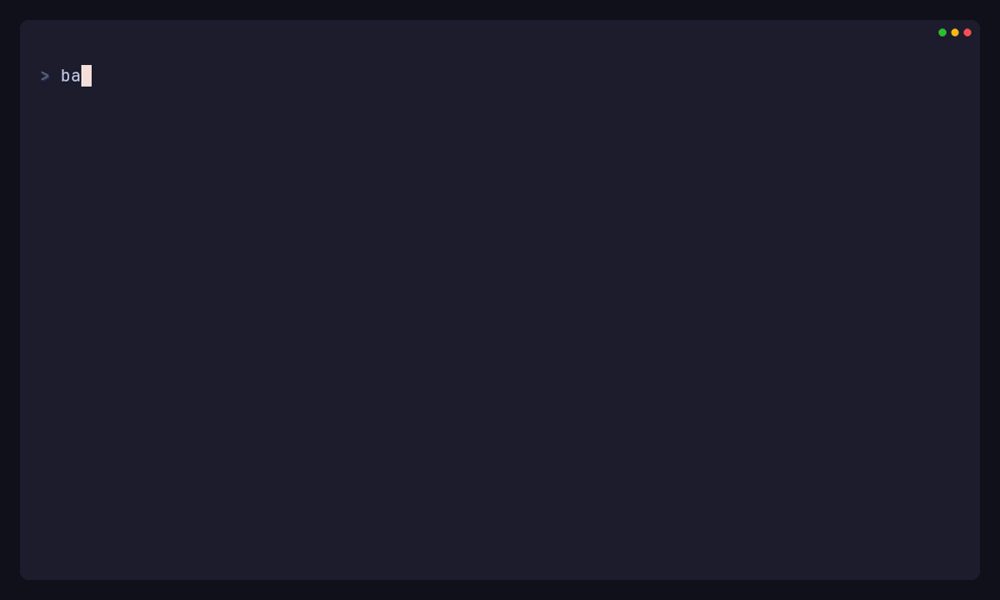

# PHP Upgrade Preflight

> [!IMPORTANT]
> **Project status: Public beta.** PHP Upgrade Preflight is open source under the [MIT License](LICENSE), free for commercial and noncommercial use.

PHP Upgrade Preflight helps you plan a PHP upgrade before changing your project. It copies your project's `composer.json` and `composer.lock` into temporary workspaces, runs Composer dependency checks there, and scans your source files for upgrade issues. The development checkout prints a short summary of blockers, next actions and assessment limits. Full JSON and Markdown reports are explicit options.


v0.3 runs on PHP `^8.0` (PHP 8.0 through PHP 8.x). The Laravel adapter provides guidance for 7в†’8, direct 7в†’9, and each upgrade to the next major version from 8в†’9 through 12в†’13.

Current compatibility checks exercise PHP 8.5.12 and Laravel 13.39.0, including real Artisan analysis and PHPUnit 13 / Pest 5 consumers. See the dated [compatibility inventory](docs/current-compatibility.md) for verification details and limits.

If your root `composer.json` requires `laravel/framework`, the analyzer can also check a sequence of upgrades within Laravel 7–13, one major version at a time. Each step is reported separately from the direct check for your final target.


The PHP version running the analyzer can differ from the target you're checking. An installation outside your project can model a newer target through Composer platform settings. The adapter can also be installed in these Laravel environments:

| Laravel | PHP |
| --- | --- |
| 8 | 8.0 |
| 9 | 8.0.2 |
| 10 | 8.1 |
| 11/12 | 8.2 |
| 13 | 8.3 |

## Public beta and compatibility

Patch releases in v0.3.x preserve the public PHP API, CLI and Artisan commands, required adapter interfaces, adapter discovery metadata, exit codes, and report schema `0.8`. They also preserve supported upgrade paths and step-by-step analysis. Individual findings and diagnostics may change after bug or security fixes, or corrections to the evidence.

The latest published release is v0.3.5. Its reports identify the tool as `0.3.5` and use schema `0.8`, unchanged since v0.3.0. On `main`, Composer aliases remain `0.3.x-dev` and internal dependency constraints remain `^0.3`. The [readiness decision](docs/readiness/release-direction.md) defers Symfony while reader benefit, real-project operating cost and maintainer capacity are evaluated. The development-tree safety and report-clarity work is unreleased; no new schema, package or v0.4 scope is approved by that decision.


The `0.2.x` and `0.1.x` lines are archived and receive no further features, bug fixes, or security fixes. Their signed release files remain available and unchanged. See [Project status and licensing](docs/project-status.md) for the upgrade path.

The analyzer doesn't apply the upgrade or run your application. Even when Composer finds compatible dependencies, you still need to check runtime behaviour and deployment. The tool is in public beta, with no claim of production readiness. Review each report, then verify the upgrade with your application's tests and deployment process. See [Project status and licensing](docs/project-status.md), [Versioning](docs/versioning.md), and [Limitations and trust boundaries](docs/limitations.md).

## Install

For a PHP 7 project, or whenever the project files must stay byte-for-byte unchanged, install the CLI and Laravel adapter in a separate tools directory:

```bash
mkdir php-upgrade-tools
cd php-upgrade-tools
composer require php-upgrade-preflight/cli:^0.3 php-upgrade-preflight/laravel:^0.3
```

Run the analyzer from that directory against your project. v0.3 doesn't ship or support a PHAR or versioned container image. This repository's Docker files are for development.

In a project running PHP 8.0 or later, you can install both packages as development dependencies:

```bash
composer require --dev php-upgrade-preflight/cli:^0.3 php-upgrade-preflight/laravel:^0.3
```

See [Installation](docs/installation.md) and [External analysis](docs/external-analysis.md) for package choices, Windows commands, and the PHP 7.4 workflow.

## Run an analysis

Start with the wizard to choose your analysis options. It detects your project, asks for the current and target PHP versions, checks your package targets, and gives you a command to reuse:

```bash
vendor/bin/upgrade-intel wizard
```


Answer the prompts one line at a time. The development wizard defaults to the short summary. You can select full JSON or Markdown and save an identical copy outside the project you're checking. The recorded demo shows the published v0.3.x Markdown workflow.


Package lookup starts with your local `composer.json`. You can also search the local cache or configured repositories. Before looking in repositories, the wizard warns that it may use the network or credentials from your environment.

Before analysis, choose restricted or compatible Composer execution. In the plan you review, the wizard explains how your choice affects network access and credential use. The reusable command includes the matching `--composer-mode` option.

For scripts and CI, use the non-interactive command and set `--format=json` explicitly. Use `--save-report=PATH` to save the selected presentation while printing it to stdout, or `--output=PATH` to write only to a file:


```bash
vendor/bin/upgrade-intel analyze \
  --path=/projects/legacy-app \
  --from-php=7.4 \
  --target=laravel/framework:^9.0 \
  --target-php=8.1 \
  --framework=laravel \
  --format=json \
  --output=/projects/reports/legacy-app.json
```

With the adapter installed in a Laravel application, you can also use Artisan:

```bash
php artisan upgrade:analyze \
  --from-php=7.4 \
  --target=laravel/framework:^9.0 \
  --target-php=8.1 \
  --format=markdown \
  --output=/projects/reports/legacy-app.md
```

Exit code `0` means a valid report was produced, even when `resolution.status` is `blocked` or `unknown`. In scripts and CI, read that field to find out whether Composer resolved the direct upgrade.

### Five-minute offline demo

The [Laravel 10 to 13 demo](examples/five-minute-demo/README.md) runs Composer dependency checks offline against local path repositories. It produces repeatable results and a schema `0.8` report you can read alongside the terminal output.

The report separates the direct Laravel 13 check, framework guidance, and step-by-step dependency checks. During the 10в†’11 upgrade, it tracks two blockers through successive attempts. The 11в†’12 step resolves, and fingerprints identify the candidate states carried forward. The 12в†’13 step stops on a different extension blocker, and a source finding calls for review.

The CSRF finding concerns deprecated aliases that still exist, so it calls for migration review. Before-and-after hashes of every target file verify that the project stayed unchanged.



## Read-only analysis

Analysis leaves your project files unchanged. Composer runs in temporary workspaces with scripts and plugins disabled, and `--output` paths must be outside the project. Tests compare every fixture file before and after a run to verify that its bytes haven't changed.

Before Composer output reaches a report or the console, redaction rules check stdout, stderr, diagnostics, and command failure messages for known secret formats. They replace URLs containing credentials, authorisation values, common token formats, and named credential fields with consistent markers. Release CI checks generated reports and archives with synthetic test secrets.

Redaction doesn't restrict Composer's access to configured credentials or declared repositories, and it can't recognise every secret format. Debug workspaces also contain copies of Composer manifests. Limit credential access, isolate untrusted projects, and review reports before sharing them.

The analyzer uses exact paths internally. Its default shareable JSON and Markdown reports replace absolute local root paths with these markers:

- `[PROJECT_ROOT]` for the analyzed project.
- `[REPORT_OUTPUT]` for the report destination.
- `[LOCAL_REPOSITORY]` for local Composer repositories.
- `[ANALYZER_WORKSPACE]` for the analyzer's temporary workspace roots.

Source file paths in the report stay relative to your project.

Use `--debug` to keep temporary workspaces for inspection. Debug reports include exact `temp_path` values, so keep those reports and workspaces private. Without `--debug`, workspace cleanup errors show only `[ANALYZER_WORKSPACE]`. Secret redaction remains active in every mode.

## Reports

**Unreleased default migration:** CLI, Artisan and the wizard select `--format=summary` and `--analysis-mode=standard` in this checkout. Published v0.3.5 keeps its previous defaults. Automation must request `--format=json`; use `--analysis-mode=full` to retain exhaustive alternative Composer probes. Formatting and execution mode are independent. The [migration and summary contract](docs/optimization/actionable-summary.md), [execution policy](docs/optimization/composer-execution.md) and [source cache contract](docs/optimization/source-facts-cache.md) describe the changes. No new release is prepared; publication requires a deliberate minor-release migration.

In this checkout, persistent source-fact caching is off by default. CLI and Artisan can opt in with
`--source-cache=PATH` using a private directory outside the analyzed project.

The [performance follow-up](docs/optimization/performance-followup.md) explains
the measured cache-off effect, remaining costs and early Composer findings. The
[earlier ten-project series](docs/optimization/results.md) records slower first
analyses and missed targets before that mitigation. These are bounded offline
Windows/Docker Desktop measurements, not a general performance guarantee.

JSON is the report's source format, and Markdown is generated from it. Published v0.3.x releases use schema `0.8`, following schema `0.7` in v0.2.1 and `0.6` in v0.1. Each report includes:


- Commands, Composer results, diagnostics, and candidate lockfile hashes for each scenario.
- A record of Composer execution with secrets redacted: compatible/restricted mode, expected version, timeouts, inherited environment, and offline policy.
- The sources of platform assumptions and decisions that may depend on the host.
- Package changes, structured blockers, detected source usages, and source findings that call for action, linked to Composer autoload ownership.
- Framework upgrade guidance and findings for each step.
- Separate direct and step-by-step results, with attempts, selected-state fingerprints, blocker histories, and changes per step. Source findings refer to the original project snapshot.
- Actions for each stage, test guidance, risk and effort estimates, uncertainties, and evidence links.

Schema `0.8` adds the required `staged_resolution` field without changing the meaning of direct `resolution` or framework guidance from schema 0.7. If your code reads several report versions, see [JSON schema and compatibility](docs/schema.md) and the [v0.3 staged-analysis contract](docs/v0.3-contract.md).

Read the Markdown **Decision Summary** before the Composer transcripts. It projects the direct and staged outcomes, first recorded blocking subject and evidence, plan actions, assessment limits, and manual validation from the JSON report. Use the [five report-state reading checklists](docs/readiness/report-reading-checklists.md) to choose the next safe action. A `low` risk grade describes observed drivers only; an unknown or degraded Composer result, skipped stage, source-scan omission, or adapter failure is not a verified low-risk upgrade. `risk.drivers`, `effort.assumptions`, and `uncertainties` qualify those cases in canonical JSON too. The hour range is an uncalibrated planning heuristic for observed dependency, source, and test work, not a project quote. Unobserved migration, deployment, runtime, and business validation work is excluded. An unavailable input report's `0-0` hours means **not estimated**, not no work.

Staged hop, attempt, process, and timeout limits are enforced. The `budgets` memory and report-size values are advisory targets; schema `0.8` records no per-run peak-memory or advisory pass result. Missing measurements are unknown, never zero or a successful check.

For Laravel upgrades across several major versions, the rule catalogue must cover every required step. Advice stops at the first gap.


Guidance is unsupported if either major version is unclear or unknown, both versions are the same, you're downgrading, or the request falls outside Laravel 7–13. A missing first step in the catalogue also makes guidance unsupported.

Read these three schema 0.8 fields separately:

| Field | What it tells you |
| --- | --- |
| `transition.framework_guidance[].status` | Whether the rules cover the upgrade path. |
| `resolution.status` | Whether Composer found a solution for the direct upgrade. |
| `staged_resolution.status` | The result of the step-by-step dependency checks. |

Six Laravel test projects model application structures, with approved JSON and Markdown snapshots in [`packages/laravel/tests/Snapshots`](packages/laravel/tests/Snapshots). The same suite runs in CI on Ubuntu and Windows.

## Packages

- `php-upgrade-preflight/core` runs the analysis and defines the report data.
- `php-upgrade-preflight/cli` provides the non-interactive `upgrade-intel analyze` command and the interactive `upgrade-intel wizard` workflow.
- `php-upgrade-preflight/laravel` provides Laravel detection, rules, and `upgrade:analyze`.

Third-party adapters register through Composer metadata to detect frameworks, choose source paths, supply rules, and group related packages. No CLI changes are needed. See [Framework adapters](docs/adapters.md).

## Documentation

- [Installation](docs/installation.md)
- [External analysis](docs/external-analysis.md)
- [Framework adapters](docs/adapters.md)
- [CLI reference](docs/cli.md)
- [Artisan reference](docs/artisan.md)
- [Composer execution policy](docs/composer-execution.md)
- [JSON schema and compatibility](docs/schema.md)
- [Project status and licensing](docs/project-status.md)
- [v0.2 report and transition contract](docs/v0.2-contract.md)
- [v0.3 staged-analysis contract](docs/v0.3-contract.md)
- [v0.3.5 release notes](docs/releases/v0.3.5.md)
- [v0.3.0 release notes](docs/releases/v0.3.0.md)
- [Laravel v0.2 transition scope](docs/laravel-v0.2-transition-scope.md)
- [Laravel coverage review and manual migration checks](docs/laravel-coverage/README.md)
- [Limitations and trust boundaries](docs/limitations.md)
- [Troubleshooting](docs/troubleshooting.md)
- [Contributing](CONTRIBUTING.md)
- [Security policy](SECURITY.md)
- [Changelog](CHANGELOG.md)
- [Versioning policy](docs/versioning.md)

## Development

The Docker environment runs PHP 8.5. Composer resolves development dependencies against PHP 8.0.30 to preserve compatibility with the lowest supported PHP version. See [Current compatibility coverage](docs/current-compatibility.md) for tested PHP and ecosystem versions, checks of projects using these packages, and the limits of PHP 8.6 preview coverage.

```bash
docker compose build --pull php
docker compose run --rm php composer install
docker compose run --rm php composer check
```

`composer check` validates all package manifests, runs the unit, integration, and smoke PHPUnit suites, performs static analysis, and checks formatting. These checks run offline with repeatable results. Compatibility installs against live repositories and dependency audits have separate workflows. See [CONTRIBUTING.md](CONTRIBUTING.md) for `test:unit`, `test:integration`, `test:smoke`, `test:all`, package-specific tests, and snapshot updates.

## License

Copyright 2026 Valentin Nikolaev. PHP Upgrade Preflight is open source under the [MIT License](LICENSE).

Releases through v0.3.1 retain the PolyForm Noncommercial License 1.0.0 they shipped with. The MIT License applies to this repository and every release after v0.3.1. The license text takes precedence over this summary.
